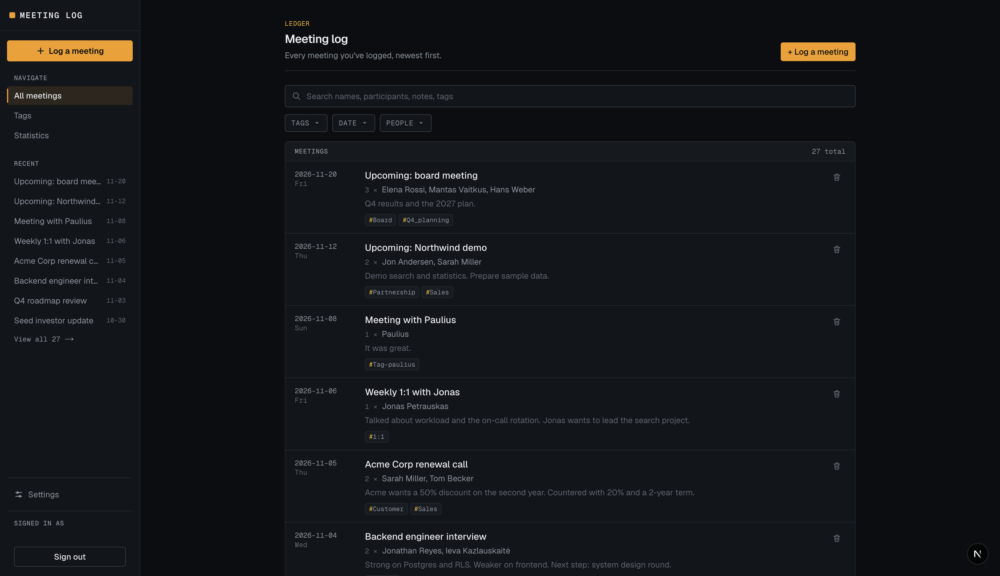

# Meeting log

A simple CRM for logging meetings, styled like a finance terminal. Sign up with email and password; your meetings, tags, and settings are stored in [Supabase](https://supabase.com), and every account sees only its own data.



## App option

**Bring an app you already have:** the meeting-log CRM from Sprint 1. It started as a browser-only app (everything in `localStorage`); this sprint moved its data into Supabase and added email/password accounts, a server-protected private area, and Row Level Security on every table.

## What it does

- **Accounts:** sign up and sign in with email and password (`/sign-up`, `/sign-in`). Every other page is private: a signed-out visitor is redirected to the sign-in page by the server before the page loads. The sidebar shows the signed-in email and a Sign out button.
- **Log meetings** with a name, date, participants, notes, and tags. Each meeting has its own bookmarkable page, where you can edit or delete it.
- **Meeting log:** every meeting, newest first, with a sidebar menu showing the 8 most recent.
- **Search and filters:** search meeting names, notes, participants, and tag names, and filter by tags, people (each with an Any/All switch), and date (this month, this year, upcoming, past, or a custom range). The database does the matching; see [Optional task](#optional-task-server-side-search).
- **Tags:** create, rename, and delete tags on the Tags page, then pick them when logging a meeting. Renaming a tag updates it on every meeting; deleting it removes it from its meetings but keeps the meetings.
- **Statistics:** meetings this month vs last month, meetings per month for the last year, who you meet most, who you haven't met in a while, and breakdowns by tag and day of the week.
- **Settings:**
  - Light, Dark, or System theme, saved to your account.
  - Export everything to a JSON backup file, and import one (it merges into the signed-in account). A backup exported from the old browser-only version can be imported too.

## How data is stored

- All data lives in a Supabase Postgres database: tables `meetings`, `tags`, `meeting_tags`, and `user_settings`. Nothing is kept in `localStorage` or `sessionStorage`.
- Every table has a `user_id` and **Row Level Security** enabled, with policies that let a user select, insert, update, and delete only their own rows. This holds even when the database is queried directly with the public key, outside the app.
- The schema, policies, and search function are SQL migrations in [`supabase/migrations/`](supabase/migrations), so the database can be recreated from scratch.

## Optional task: Server-side search

> Add a search box that filters items by querying Supabase directly, so the database returns only the matching rows instead of the browser filtering them.

Delivered on its own `feat/server-side-search` branch and merged in [pull request #1](https://github.com/TuringCollegeSubmissions/pgrigo-BAI.2.8/pull/1) of the submission repository (developed and reviewed as [pull request #4](https://github.com/Paugrigo/crm-app-sprint2/pull/4) in [Paugrigo/crm-app-sprint2](https://github.com/Paugrigo/crm-app-sprint2), the working repository).

- The search box on the meeting log (`/`) calls a Postgres function, `search_meetings(...)`, through Supabase. Only the matching meetings come back.
- Text search is a case-insensitive substring match on the meeting name, notes, participants, and tag names. `%` and `_` in the search text match literally.
- Beyond the brief: Tags, People, and Date filters, also applied in the database and combined with the search text.
- The function runs as the signed-in user (`security invoker`), so Row Level Security applies exactly as for a plain query: you can only ever find your own meetings. Only signed-in users can call it.
- Search text and filters live in the URL, so reload, Back/Forward, and bookmarks keep them. Typing waits 250 ms before searching (Enter searches right away, Escape clears), and the previous results stay on screen, dimmed, while new ones load.

## Further optional tasks

Also completed, as part of the Supabase move in [pull request #3](https://github.com/Paugrigo/crm-app-sprint2/pull/3) (`feat/supabase-auth`) rather than on branches of their own:

- **Self-service sign-up page.** New users register themselves at `/sign-up` with an email address and password. With email confirmation on, the page asks them to check their inbox; the link in Supabase's email lands on `/auth/confirm`, which signs them in and opens the meeting log.
- **Track database changes with migrations.** Every change to the database structure (tables, columns, Row Level Security policies, privileges, and the search function) is a SQL migration in [`supabase/migrations/`](supabase/migrations), applied with the Supabase CLI (`supabase db push`). The folder holds the full history of how the database was built, so a new project can be set up from it.

## Run it locally

You need [Node.js](https://nodejs.org) 20.9 or newer and a Supabase project (the free plan is enough).

### 1. Set up the database

Apply the migrations in [`supabase/migrations/`](supabase/migrations) to your Supabase project, in filename order. Either:

- with the [Supabase CLI](https://supabase.com/docs/guides/local-development/cli/getting-started): `supabase link --project-ref <your-project-ref>`, then `supabase db push`, or
- in the dashboard's **SQL Editor**: paste and run each file in order.

### 2. Set the environment variables

Copy the example file and fill in the two values:

```bash
cp .env.example .env.local
```

| Variable | Where to find it |
|---|---|
| `NEXT_PUBLIC_SUPABASE_URL` | Supabase dashboard → your project → **Connect** (or **Project Settings → Data API**): the Project URL, like `https://<project-ref>.supabase.co` |
| `NEXT_PUBLIC_SUPABASE_PUBLISHABLE_KEY` | **Project Settings → API Keys**: the publishable key (`sb_publishable_…`) |

Never use the secret (service role) key here. `.env.local` is gitignored.

### 3. Start the app

```bash
npm install
npm run dev
```

Then open [http://localhost:3000](http://localhost:3000). You'll land on the sign-in page.

### 4. Create an account

- **From the app:** open **Sign up**. If email confirmation is on in your project (Authentication → Sign In / Providers → Email), Supabase emails a confirmation link; open it in the same browser. For the link to point at your local app, set **Authentication → URL Configuration → Site URL** to `http://localhost:3000`. Supabase's built-in email sender only sends a few emails per hour.
- **From the dashboard** (quickest for testing): **Authentication → Users → Add user**, with **Auto Confirm User** checked, then sign in with that email and password.

Other commands:

- `npm run build`: production build (`npm run start` serves it)
- `npm run lint`: run ESLint

## Built with

- [Next.js](https://nextjs.org) 16 (App Router)
- React 19
- TypeScript
- Tailwind CSS v4
- [Supabase](https://supabase.com) (Postgres, Auth, Row Level Security) via `@supabase/supabase-js` and `@supabase/ssr`
- No chart library: the statistics bars are plain CSS.

Working on the code? [`AGENTS.md`](AGENTS.md) describes the project structure, conventions, and design decisions.
